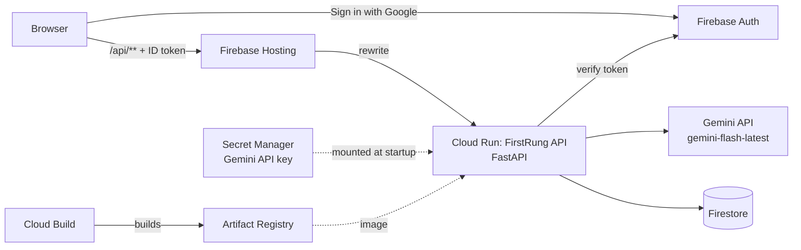

# FirstRung

**Seniors show a task once. New hires get an onboarding plan that adapts to them.**

AI Builder Cup 2026 · Track: Future of Work & Enterprise Productivity

A senior records their screen while doing a real task and explaining it. Gemini turns the recording into a playbook. A manager describes a new hire's role, and FirstRung builds a day-by-day onboarding plan from the team's playbooks, **flags the knowledge nobody has recorded yet**, and adapts as the new hire works (hints when stuck, skips what they already know).

Live: https://firstrung-993fd.web.app

## Architecture (API-first)



The API is the product; the web app is only the first client. Every endpoint except `/api/health` requires a Firebase ID token (`Authorization: Bearer <token>`), so a Google Chat bot, mobile app or HR system can call the same endpoints after signing the user in.

| Endpoint | What it does |
| --- | --- |
| `GET /api/health` | Infra check, no login: Cloud Run is up, Gemini mode, Firestore reachable |
| `GET /api/me` | Login check: who is signed in (also saves the user profile) |
| `GET /api/hello` | Infra check: one real Gemini call, end to end |
| `POST /api/capture` | Screen recording (multipart `file`, optional `hint`) → structured playbook. The web app calls the Cloud Run URL directly for this one (it can take longer than Hosting's 60 s limit) |
| `POST /api/youtube/resolve` | `{url, whole_playlist}`: a YouTube video or playlist link → its videos with title, channel, length, and whether each can be imported (public, ≤ 30 min, not already in the library). No Gemini call, nothing spent yet |
| `POST /api/capture/youtube` | `{video_id, hint}` → playbook. Gemini watches the public video straight from its URL; nothing is downloaded. Timestamps in the playbook link back to that moment on YouTube |
| `GET /api/me` · `POST /api/me/role` | Who is signed in, their roles and active role · switch role ("View as") |
| `POST /api/plans/{id}/assign` · `DELETE /api/plans/{id}` | Assign a plan to a new hire by email (invites them) · delete a plan (manager) |
| `POST /api/requests` · `GET /api/requests` · `POST /api/requests/{id}/decline` | Manager asks an expert to record a gap · managers see all requests, experts see theirs · expert declines with a reason and a suggestion. Answering: pass `request_id` to `/api/capture` or `/api/capture/youtube`; the request closes and the plan is re-checked |
| `GET /api/people` | Known experts and new hires, for the pickers (manager) |
| `POST /api/session/voice` | Multipart `plan_id`, `item_index`, `file` (WAV): a spoken "I'm stuck" → what was heard + a hint in the same language |
| `POST /api/speak` | `{text}` → WAV audio (Gemini text-to-speech) |
| `POST /api/coach/start` | `{plan_id, item_index}` → single-use token for a live voice coach session (Gemini Live API) |
| `GET /api/playbooks` | The team's playbook library, newest first |
| `GET /api/playbooks/{id}` · `DELETE /api/playbooks/{id}` | One playbook / remove it |
| `POST /api/plan` | `{role_description, days}` → onboarding plan, coverage %, **gap report** |
| `GET /api/plans` | Manager view: every plan with progress (% through, done, skipped, times stuck) |
| `GET /api/plans/{id}` | One plan with its saved progress, so the new hire resumes after a refresh or on another device |
| `POST /api/plans/{id}/recheck` | Re-match an existing plan's core tasks against the current library, after someone has recorded a gap. Coverage and gaps are recomputed; the plan and the new hire's progress are kept |
| `POST /api/plans/{id}/restart` | Start a plan over: progress, stuck notes and coach usage are cleared; the tasks, gaps and timetable stay. The web app offers Undo for 5 seconds first |
| `POST /api/session` | `{plan_id, item_index, outcome: done/stuck/already_know, note}` → the plan adapts and progress is saved. "Already know" skips the whole topic (every later item using the same playbook); "stuck" returns a hint grounded in that playbook's steps and gotchas, and tries a new angle if earlier advice didn't help |

Interactive API docs are at `/docs` on the Cloud Run URL.

### How gap detection works

1. Gemini reads the role description and lists the role's 5–10 core tasks, each with an importance (critical / regular / occasional), the day it is first needed, and who should record it.
2. For each task it names the library playbook that actually teaches it, or none. The API discards any playbook ID that doesn't exist.
3. **Coverage is computed by the API, not guessed by the model**: the importance-weighted share of core tasks that have a playbook. Uncovered tasks become the gap report, most important first, and the plan schedules a "shadow" session before each one is needed.
4. **Closing the loop**: a plan is a snapshot of the library when it was built. When someone records a missing task, "Re-check coverage" matches the plan against today's library (by job outcome, not exact wording). Tested: an Accounts Executive plan went from 12% to 31% after a Hindi-narrated invoice reconciliation was recorded.

### Roles: manager, expert, new hire

| Role | Sees and does |
| --- | --- |
| **Manager** | Everything: builds plans, **assigns** a plan to a new hire by email, **asks an expert** to record a gap, sees team progress, deletes or restarts plans |
| **Expert** | Capture and the library, plus **"Recording requests for you"**: record it (screen, upload or YouTube) or decline with a reason and who to ask instead |
| **New hire** | Only the plans assigned to them, and only the playbooks those plans use |

The loop: the manager asks an expert to record a gap → the expert sees the request when they sign in and records it → the request closes and **the plan's coverage is re-checked automatically** → the new hire's plan now has that playbook.

How people get roles: the first person to sign in becomes a manager; assigning a plan invites that email as a new hire; asking an expert invites that email as an expert. One person can hold several roles. **The API enforces roles** (a new hire asking for someone else's plan gets 404), and Firestore rules still deny all direct client access.

**Demo mode** (`DEMO_MODE=1`, set in `infra/cloud_run.tf` for the hackathon): every signed-in user holds all three roles and switches with **"View as"**, so judges can try the whole loop with one Google account. Set it to `0` for a real team.

### Voice: listen, ask by voice, live coach

Every open step in the new hire's plan has **I'm stuck** and **Live coach** next to it. "I'm stuck" opens a help panel inside that step, with an example problem Gemini wrote for that exact step (e.g. *GitHub says Permission denied (publickey) when I clone*), and asking for help makes it the current step.

For that step:

- **Listen**: any hint is read aloud by Gemini text-to-speech (`gemini-3.8-flash-lite-tts`, falling back to `gemini-3.8-flash-tts`).
- **Ask by voice**: tap, say what you're stuck on in English, Hindi or Hinglish, tap again. The API checks the recording isn't silent, Gemini writes down what was said (with no task context, so it can't invent a likely question from noise), and the hint comes back in the same language and is read aloud.
- **Talk to a live coach**: a real-time voice conversation with the **Gemini Live API** (`gemini-3.8-live`). The coach is grounded in that task's playbook (steps, gotchas, checks) and in earlier stuck notes. With **Share my screen** it sees one picture per second of the new hire's screen and talks about what it actually sees. The new hire can interrupt at any time; captions show both sides.

How the live coach stays secure: the browser connects to Gemini directly over a WebSocket for low latency, using a **single-use token** (30-minute expiry) minted by `POST /api/coach/start`. The coach's instructions, voice and settings are locked into the token, and the real API key never leaves Cloud Run. Context-window compression keeps audio + screen sessions from stopping after 2 minutes.

### Import from YouTube

Teams often already have training videos. Paste a YouTube video or playlist link on the Capture page, tick the videos you want, and each becomes its own playbook (one task per playbook, so gap detection can match it). Gemini reads public videos directly from the URL. Single videos need no extra setup; playlists, video length and private/unlisted detection use the YouTube Data API with a key stored in Secret Manager (`youtube-api-key`), created with:

```bash
gcloud services api-keys create --key-id=firstrung-youtube --display-name="FirstRung YouTube" \
  --api-target=service=youtube.googleapis.com
gcloud services api-keys get-key-string firstrung-youtube --format="value(keyString)" \
  | tr -d '\n' | gcloud secrets versions add youtube-api-key --data-file=-
```

Only public videos work (Gemini can't open private or unlisted ones); videos over 30 minutes are skipped, and at most 10 are imported at a time.

### Languages

Seniors can narrate in English, Hindi or Hinglish; the playbook is always written in clear English and records the narration language. Tested with a Hindi-narrated recording of an invoice reconciliation: every step's "why" was taken from the Hindi narration.

## Repository layout

| Path | What |
| --- | --- |
| `backend/` | FastAPI app (`main.py`), Gemini client with model fallback (`gemini.py`), login check (`auth.py`), prompts, schemas, storage |
| `frontend/public/` | Web app, no build step: `index.html` (views), `styles.css` (light + dark themes), `app.js` (Google sign-in, API calls, screen recording, plan and new-hire views), `img/` (real product screenshots from real Gemini output, light + dark) |
| `infra/` | Terraform for all Google Cloud infrastructure |
| `firestore.rules` | Firestore security rules (deny all direct client access) |
| `build.sh`, `deploy.sh`, `cloudbuild.yaml` | Build the API image with Cloud Build and deploy |

## Run locally (no Google account needed)

```bash
cd backend
python3 -m venv .venv && source .venv/bin/activate
pip install -r requirements.txt
STATIC_DIR=../frontend/public uvicorn main:app --reload --port 8080
```

Open http://localhost:8080. With no key it runs in **MOCK mode** (sample data) and sign-in is off, so the frontend can be built without any cloud setup. For real Gemini locally, add `GEMINI_API_KEY=your_key` in front of the `uvicorn` command (never commit the key).

## Deploy to your own Google Cloud project

Prerequisites: `gcloud`, `terraform` (≥ 1.6) and `firebase` CLIs, and a Google Cloud project with billing and Firebase added.

```bash
gcloud auth login && firebase login
gcloud config set project YOUR_PROJECT_ID
gcloud auth application-default login           # lets Terraform act as you

cd infra
cp terraform.tfvars.example terraform.tfvars     # set project_id
terraform init
terraform apply -target=google_secret_manager_secret_iam_member.api_reads_gemini_key  # registry, APIs, empty secret
cd .. && ./build.sh                              # first API image
```

Then, once:

1. **Gemini key** from https://aistudio.google.com/apikey, stored without touching any file:
   ```bash
   read -rs "GEMINI_KEY?Paste your Gemini API key: "; echo
   printf '%s' "$GEMINI_KEY" | gcloud secrets versions add gemini-api-key --data-file=-
   unset GEMINI_KEY
   ```
2. **Google sign-in**: Firebase console → Authentication → Sign-in method → Google → Enable.
   (Kept out of Terraform so the OAuth client secret never lands in Terraform state.)

Finally:

```bash
cd infra && terraform apply && cd ..             # Cloud Run, Firestore, rules, IAM
./deploy.sh                                      # API image + web app
```

After that, `./deploy.sh api` ships backend changes and `./deploy.sh web` ships the web app. Infrastructure changes go in `infra/*.tf` followed by `terraform apply`.

### Security choices

- The Gemini key lives only in Secret Manager; Terraform creates the secret and its access rule, never the value.
- Cloud Run runs as a dedicated service account with only Firestore access and read access to that one secret. Images are built by a separate builder account.
- Firestore rules deny all direct client access; all data flows through the API, which verifies the Firebase ID token.
- The web app has no keys in its code: Firebase Hosting serves the public Firebase config at `/__/firebase/init.json`.

## Models

`GEMINI_MODELS` (set in `infra/cloud_run.tf`) is a fallback list, tried in order: `gemini-flash-latest,gemini-3-flash-preview`. `gemini-2.5-*` models are avoided because they shut down on 16 October 2026. Voice uses Gemini's dedicated speech models: `gemini-3.8-live` (live coach) and `gemini-3.8-flash-lite-tts` / `gemini-3.8-flash-tts` (read aloud), configurable with `GEMINI_LIVE_MODEL` and `GEMINI_TTS_MODELS`.

Note: a project linked to a billing account uses the Gemini API paid tier, which needs prepaid credits bought in AI Studio. Google Cloud free-trial credits don't cover Gemini API usage.

## Known limits (prototype)

- Videos are sent inline: keep recordings under ~25 MB (2–3 minutes).
- Requests through Firebase Hosting time out after 60 seconds; long video captures should call the Cloud Run URL directly.
- One shared workspace: every signed-in user sees the same playbook library and plans.
- One new hire per plan: progress is stored on the plan itself.

## Google tools used

Gemini API (video understanding, structured output, text generation) · Cloud Run · Cloud Build · Artifact Registry · Firestore · Firebase Authentication · Firebase Hosting · Secret Manager · Terraform (Google provider)
